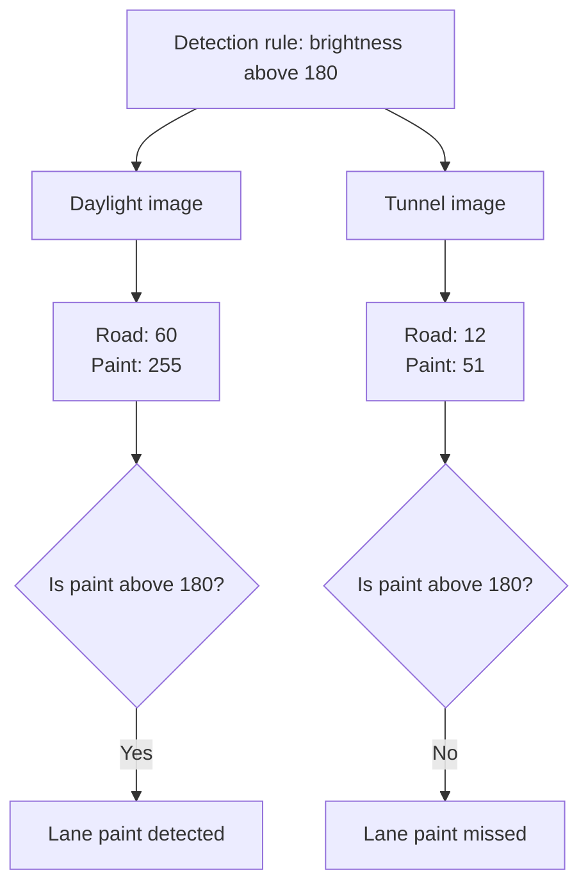
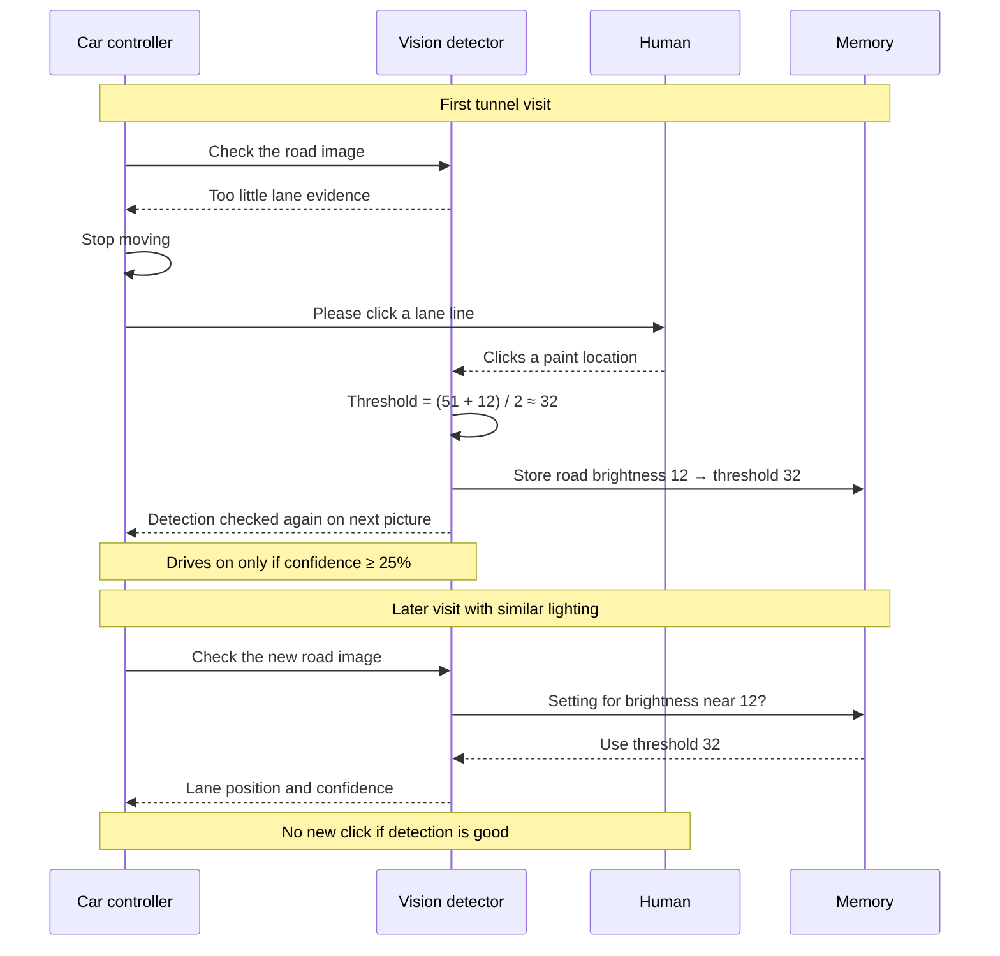
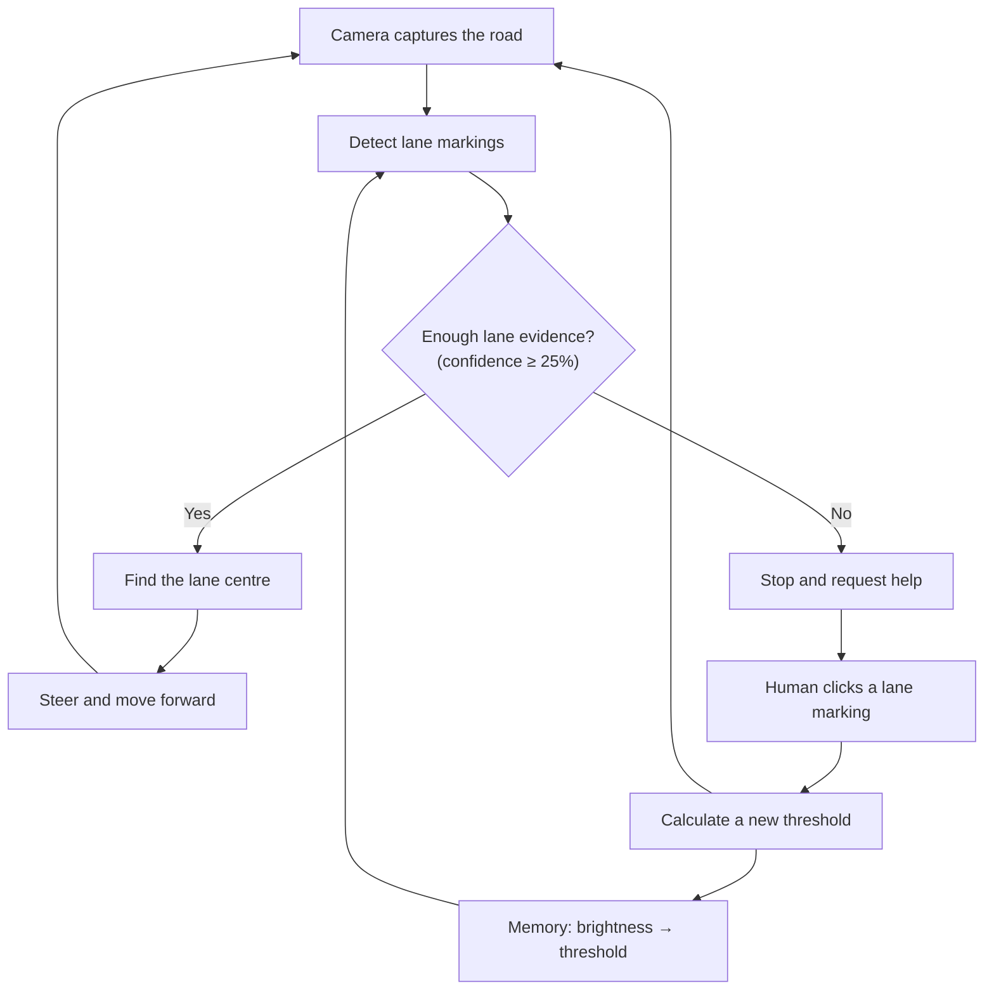

# Project Explanation (read this first)

**In one sentence:** a simulated lane-following car that **asks for help when its
vision becomes unreliable, learns a better detection setting from one click, and
remembers it for similar lighting later**.

The most interesting part is **what happens after the human helps**: one click
improves the car's *future* behaviour, not just the current moment.

---

## 1. The car's basic job

The road has a white boundary line on each side. The car must stay between them.
Every step it answers three questions:

1. Where is the left lane line?
2. Where is the right lane line?
3. Which way should I steer to stay between them?

Its virtual camera gives a picture. The program finds the lines in the picture
and calculates a steering correction.

**Example** (the camera image is 160 pixels wide, so its centre is 80):

| Item | Position in the image |
|---|---:|
| Left line | 40 |
| Right line | 140 |
| Middle of the lane = (40 + 140) / 2 | **90** |
| Middle of the camera image | 80 |

The lane middle is **10 pixels to the right**, so the car steers right.
It then moves a little, takes a new picture, and repeats.

This repeated **observe → decide → act → observe again** loop is what makes it an
**autonomous control system**.

---

## 2. The camera gives a picture; the program needs a rule to read it

In a grayscale image every pixel has a brightness from **0 (black) to 255 (white)**.

In daylight:

- road brightness ≈ **60**
- lane paint brightness ≈ **255**

So a simple rule works:

> A pixel brighter than **180** is possible lane paint.

The number 180 is called a **threshold**, which is simply a cut-off.

| Surface | Brightness | Brighter than 180? | Result |
|---|---:|---|---|
| Road | 60 | No | background |
| Paint | 255 | Yes | lane paint |

**The program does not "understand" white paint like a person. It just applies a brightness rule.**

---

## 3. Why the tunnel causes a problem

Inside the tunnel, both road and paint get darker:

| Surface | Daylight | Tunnel |
|---|---:|---:|
| Road | 60 | 12 |
| Lane paint | 255 | 51 |

The program still uses threshold **180**. Now **both** 12 and 51 are below 180,
so it detects **nothing**.



**The lane still exists. The camera still gives a picture. Only the rule stopped working.**
The failure is in *interpreting* the image.

The **basic car** keeps driving when this happens. On a curve it goes straight,
leaves the road and crashes (in our test: at step 98 in the tunnel).

---

## 4. How detecting the lines makes the car steer

```
lane middle = (left line + right line) / 2
error       = lane middle − camera centre      (camera centre = 80)
turn        = 0.006 × error
```

| Lane middle appears… | Error | Steering |
|---|---|---|
| left of centre | negative | steer left |
| at the centre | ≈ 0 | little or no correction |
| right of centre | positive | steer right |

The next camera picture shows the effect of this turn. That is **feedback**.

---

## 5. Improvement 1: know when detection is unreliable

The car looks at **60 rows** of the camera picture (the band 30 to 90 pixels ahead)
and counts how many rows contain a detected line.

```
confidence = rows with a detected line / rows inspected × 100%
```

| Rows with a line (of 60) | Confidence | Decision |
|---:|---:|---|
| 54 | 90% | continue |
| 30 | 50% | continue |
| 6 | 10% | **stop and ask for help** |

Our rule: **if confidence falls below 25%, stop and ask for help.**
The car is effectively saying: *"My detector is finding too little lane information to continue."*

**Be honest about this score:**
- It measures **how much lane evidence** was found. It is **not** the probability of being safe.
- A bright object mistaken for a line could still give a high score.
- 25% is **our chosen setting**, not an official safety limit.

---

## 6. Improvement 2: the human's help *teaches* something

The car stops and asks the human to **click one lane line** in the camera picture.
The click is a **labelled example**: *"this spot is lane paint."*

The human does **not** calculate anything or drive the car. The program does the rest:

- paint brightness near the click → **51**
- typical road brightness in that row (the median) → **12**

```
new threshold = (paint + road) / 2 = (51 + 12) / 2 = 31.5 ≈ 32
```

| Surface | Brightness | Above 32? | Result |
|---|---:|---|---|
| Road | 12 | No | background |
| Paint | 51 | Yes | lane paint |

**The same picture that failed with 180 works with 32.**

After the click, the car **checks again on the very next picture**. If confidence
is still below 25%, it asks again. It only drives on when detection has recovered.

**What "learning" means here:** using human feedback to update one number
(the threshold) that affects future decisions. No neural network and no big dataset.

**Limits of one click:**
- It only calibrates **brightness**. It teaches nothing about lane shapes, obstacles or traffic rules.
- The car rejects a click that is **not brighter than the road** ("please click a white line").
  But a bright spot is **not automatically** a lane line, so a wrong click on something bright would still be accepted.

---

## 7. Improvement 3 (the strongest): remember the correction

Without memory, the car would need the same help **every lap**. Our car stores:

| Observed road brightness | Threshold to use |
|---:|---:|
| about 60 (daylight, factory setting) | 180 |
| about 12 (learned in the tunnel) | 32 |

On a later visit to the tunnel:

1. it sees road brightness near **12**
2. it finds the stored entry for similar brightness
3. it uses threshold **32**
4. it checks confidence as usual
5. if detection works, it continues with **no new click**



**The value of the first click lasts beyond the moment it was given.**

Two details from the actual code:
- The choice is made **per row** of the picture, so half-dark pictures (at the tunnel entrance) work too.
- **Sanity check:** a remembered threshold is skipped if it is not brighter than the current road, because then the whole road would look like paint.

**Important:** the memory lives only while the program runs. **Closing and restarting
the program resets it** to the daylight setting. It is not saved to a file.

---

## 8. Why remember brightness instead of location?

| Remember by location | Remember by brightness (ours) |
|---|---|
| "Use 32 **at this tunnel**." | "Use 32 **when the road looks this dark**." |
| Only helps at that one place | Can help **anywhere** with similar light, e.g. a storm |

**But be careful:** similar road brightness does **not** guarantee the same paint
brightness or image quality. That is why the car **keeps checking confidence** even
with a remembered setting, and asks again when needed. In our storm test the car
asked **once** for the new storm lighting, then continued.

---

## 9. The complete system in one diagram



Two paths:
- **Normal driving:** camera → detect → find centre → steer → next picture
- **Detection failure:** stop → ask for a click → calculate a better setting → check the picture again

**The human only helps the car *interpret* the picture. The program still calculates the setting and does all the driving.**

---

## 10. Where exactly is the novelty?

| Behaviour | What it adds |
|---|---|
| Detect lane markings | Normal lane following |
| Monitor detection confidence | Recognises some vision failures |
| Stop and request help | Doesn't continue blindly |
| Learn from one clicked example | Fixes the detector with tiny human effort |
| Store the setting by brightness | Reuses it under similar conditions |

**Our distinguishing feature is the complete loop: ask for a small correction →
turn it into a vision setting → reuse it later.**

There are two meanings of "novelty":

| Kind | Meaning | Our status |
|---|---|---|
| **Project-level** | A meaningful improvement over the basic version | ✅ Yes, and measured (below) |
| **Research-level** | Original compared with all published work | ⚠️ Not proven. Our search found the separate pieces (asking for help, remembering perception failures, slowing when unsure) but **no work combining them like this**. A full literature review would be needed to claim more. See the sources in the README. |

**Say in class:** *"We found no prior work doing this exact combination."*
**Never say:** *"This is the first in the world."*

---

## 11. Evidence: does the feature actually help?

| Claim | How we show it |
|---|---|
| The fixed threshold fails in darker light | Live: the vision picture goes empty in the tunnel; the basic car crashes |
| The confidence rule changes behaviour | Live: the smart car stops with a red box when confidence drops |
| One click fixes detection | Live: lines reappear in the vision picture right after the click |
| Memory reduces repeated help | Live: lap 2 passes the tunnel with no click; the "help clicks" counter stays at 1 |
| The car still completes its task | `--compare`: completed laps, not just crashes |

**Measured results.** Run `python lane_car.py --compare` (about 3 minutes) to reproduce these:

| 30 random dark worlds (oval, tunnel + storm) | Basic car | Our car |
|---|---|---|
| Crashed | 30 / 30 | **0 / 30** |
| Finished 2 laps | 0 / 30 | **28 / 30** |
| Safe stop (too dark even with help) | 0 | 2 / 30 |
| Help clicks lap 1 / lap 2 | – | 32 / 13 |

| 30 random roads (3–5 tunnels each, patchy light, surprise dark patches) | Basic car | Our car |
|---|---|---|
| Crashed | 30 / 30 | **0 / 30** |
| Finished 2 laps | 0 / 30 | **30 / 30** |
| Help clicks lap 1 / lap 2 | – | 51 / 3 |

The second test has **124 tunnels in total, but needed only 51 clicks**, because
tunnels with similar light share one memory. This is the memory transferring to new
places, measured.

### Why random roads, many tunnels and surprise patches?

A car that works on **one oval** might just be lucky with that one shape. So we also test:
- **random road shapes:** a different curvy loop every time (`G` key for a new one);
- **3 to 5 tunnels per road**, each with **its own darkness** (open road → tunnel → open road …);
- **mixed light:** tunnel entrances fade in gradually, and patchy ±15% light covers everything;
- **surprise dark patches** that appear and disappear **while the car is driving** (`P` key drops one in front of it).

These harder tests found and fixed real weaknesses, which made the car more fault tolerant:
1. Light is now judged **around each pixel** (31 × 31 area), not per row, so a tunnel
   edge that cuts diagonally across the picture can't fool it.
2. If one click doesn't bring the lines back, the car **stops safely** instead of asking forever.

Why completed laps matter: a car could avoid every crash by **never moving**. So we
report finished laps too, not only crashes.

**What we did *not* measure yet (good next steps):**
- **Time spent stopped** waiting for help.
- A third version, **"help but no memory"** (asks and learns, but forgets after every
  light change). Comparing it with our car would isolate exactly how much the
  **memory** helps. Today we show memory's value through the lap-1 versus lap-2 clicks
  (in the fixed tunnel scenario: 1 click on lap 1, **0** on lap 2).
- The automatic tests use a **simulated human** who always clicks a correct line.

---

## 12. Limitations (say these confidently)

- It's a **simulation**: a flat road (oval or random smooth loop), clean white paint, a top-down camera, simple noise.
- Real roads have glare, rain, faded paint and shadows that cross the lane.
- It needs a **human nearby** to click (a real car could ask a remote operator).
- Memory is **lost when the program closes**.
- The 25% confidence rule and the "halfway" threshold are **simple design choices**, not proven optimal.
- In 2 of 30 random oval worlds (tunnel plus storm) it was too dark even with help, so the car **stopped safely** but could not finish.

---

## Summary

> A simulated self-driving car that **notices when its vision fails**, **stops instead
> of crashing**, **learns a new vision setting from one human click**, and **remembers
> it for similar lighting**. In 60 random test worlds, crashes went from 60 to 0.
